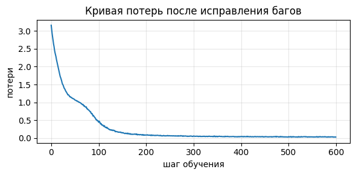
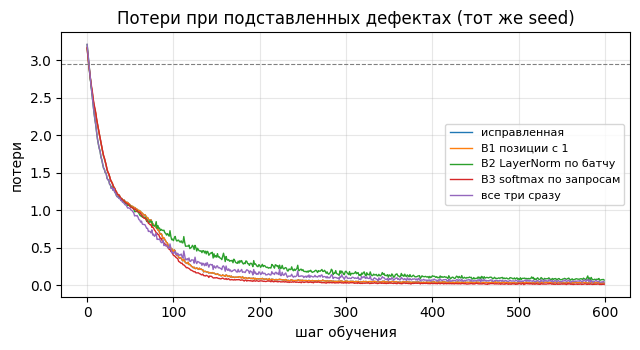

# Отчёт по ДЗ 1 «Внимание своими руками»

Seed: 42. Окружение и инструкция по воспроизведению — в [README.md](README.md).
Ноутбуки с выводом всех ячеек (прогон в Colab): `dz1-attention.ipynb`, `dz1-bughunt.ipynb`.
Все числа ниже взяты из этих выводов.

## Шаг 1. Реализация функций

Реализованы `split_heads`, `merge_heads`, `scaled_dot_product_attention`, `TransformerBlock.forward`.
Все проверки в конце ноутбука пройдены: **17 из 17, «Все проверки зелёные»**.

- `split_heads`: `x.reshape(B, L, H, d_head).permute(0, 2, 1, 3)` — сначала разворачиваем последнюю ось
  в `(H, d_head)`, потом переставляем оси, поэтому голова `h` получает свой кусок каналов
  `[h·d_head, (h+1)·d_head)`. Если сразу сделать `reshape(B, H, L, d_head)`, форма та же, а содержимое
  перемешано между головами: проверка смотрит именно на содержимое.
- `merge_heads`: `x.permute(0, 2, 1, 3).reshape(B, L, H·d_head)` — точная обратная операция. После
  `permute` тензор не лежит в памяти подряд, `reshape` при необходимости сам копирует данные.
- `scaled_dot_product_attention`: логиты `einsum('bhqd,bhkd->bhqk') · d_k^-1/2`; маска подставляет
  `-inf` в логиты до softmax; `softmax(dim=-1)` по ключам; dropout к весам; выход `einsum` с `V`.
- `TransformerBlock.forward`: pre-norm, `mid = x + attn(norm1(x))`, `out = mid + ffn(norm2(mid))`,
  возвращается `(out, weights)`. Остаточный путь не нормализуется: по нему градиент идёт в обход
  подслоёв (проверка с обнулёнными подслоями возвращает вход без изменений).

**Самое неочевидное решение в TODO 3 — способ маскирования.** Значение `0` в логите запрещённой
позиции не работает: `exp(0) = 1`, и позиция получает вес наравне с нейтральной из разрешённых.
Нужно `-inf`: `exp(-inf) = 0`, и softmax сам перенормирует разрешённые позиции, так что строка
остаётся распределением. Зануление весов после softmax ломает ту же нормировку: строка суммируется
меньше чем к единице. Цена `-inf`: если замаскирована вся строка, softmax считает `0/0` и возвращает
`NaN`. В причинной маске диагональ разрешена (токен видит сам себя), поэтому этого не случается,
но при масках с паддингом об этом нужно помнить.

## Шаг 2. Найденные ошибки (вариант seed 42, 3 ошибки)

Строки указаны по ячейке «Код с подсаженными ошибками» в том виде, как она выдана. Колонка «Что
падает» измерена: каждый дефект вставлялся обратно в исправленный код, и прогонялись те же 17
открытых проверок (ячейка «Какие проверки ловят каждый баг» в `dz1-bughunt.ipynb`).

| # | Функция и строка | Механизм поломки | Как исправили | Что падает |
|---|---|---|---|---|
| 1 | `sinusoidal_positional_encoding`, строка 39: `torch.arange(1, length + 1)` | Нумерация позиций с 1 сдвигает весь массив: у токена №0 вектор позиции №1 (синусы не нули, косинусы не единицы), и кодирование не совпадает с формулой из статьи. Так как сдвиг одинаков для всех токенов, разности фаз между позициями сохраняются, и модель дефект почти не замечает: в потерях он не виден. | `torch.arange(0, length)` — отсчёт с нуля. | 2 из 17: совпадение с формулой, нулевая позиция |
| 2 | `LayerNorm.forward`, строки 60–61: `mean`/`var` по `dim=0` | Статистики считаются по оси батча для каждого канала, то есть получается BatchNorm без бегущих статистик. Нормировка токена зависит от соседей по батчу, а признаки внутри токена не центрируются. В `generate` батч состоит из одной строки: дисперсия по оси из одного элемента равна 0, `x − mean = 0`, и слой отдаёт один `bias`, стирая информацию о входе. | `dim=-1` — статистики по признакам внутри токена. | 4 из 17: нормировка токена, независимость от батча, оба теста `generate` |
| 3 | `scaled_dot_product_attention`, строка 101: `softmax(scores, dim=-2)` | Нормировка идёт по оси запросов, а не ключей, и строки матрицы внимания не суммируются к 1. В знаменатель веса `(i, j)` попадают логиты запросов `i' > i`, а они зависят от более поздних токенов, поэтому причинность нарушена, хотя нули маски на месте. У запроса 0 единственный разрешённый ключ делится на сумму по всему столбцу и получает вес меньше 1; у последнего ключа разрешён лишь один запрос, и его вес всегда равен 1 независимо от логита. | `dim=-1` — softmax по ключам, каждая строка суммируется к 1. | 5 из 17: эталон PyTorch, сумма весов, масштаб, маска, отсутствие подглядывания в будущее |

Все три дефекта вместе роняют 10 из 17 проверок; после исправлений проходят все 17.

## Обучение исправленной модели

Заготовленная ячейка из задания: игрушечный корпус — фраза «алгоритм внимания смотрит на все
позиции сразу. », повторённая 200 раз (словарь 19 символов, `ln|V| = 2.94`). Модель: `d_model=128`,
2 слоя, 4 головы, dropout 0.1; AdamW, lr 3e-4, батч 32, контекст 64, 600 шагов, seed 42. Единственное
изменение в ячейке: `torch.manual_seed(0)` заменён на `torch.manual_seed(SEED)`.

| Шаг | 0 | 100 | 200 | 300 | 400 | 500 |
|---|---|---|---|---|---|---|
| Потери | 3.157 | 0.443 | 0.089 | 0.056 | 0.045 | 0.043 |

Итог: **3.157 → 0.029**. Стартовое значение лежит чуть выше `ln|V| = 2.94`: модель в начале раздаёт
символам почти равные вероятности, небольшой избыток даёт шум инициализации. К сотому шагу потери
упали примерно в семь раз, значит градиентный путь исправен.



Пример генерации (`temperature=0.8`, `top_k=10`, старт — «а», `torch.manual_seed(42)`):

```
а все позиции сразу. алгоритм внимания смотрит на все позици сразу. алгоритм внимания смотрит на все позиции сразу. алгоритм внимания смотрит на все позиции сразу. алгоритм внимания смотрит на все пози
```

Модель воспроизводит структуру данных: слова, пробелы, точку в конце фразы, а не случайную
последовательность символов. Одна опечатка («позици») показывает, что запоминание не абсолютное.

**Оговорка про ориентир из задания.** Ориентир (4.20 → 1.76, словарь 62 символа, текст с именами
персонажей) получен на другом корпусе. Выданный ноутбук обучает на одной повторяющейся фразе,
поэтому потери падают намного ниже, и абсолютные значения сравнивать нельзя. Здесь важны старт
около `ln|V|`, быстрое падение и структурированный текст. Валидационной выборки нет, поэтому
утверждение «модель обобщает» не делается: показано только, что код рабочий.

## Контрольный эксперимент: как баги выглядят в обучении

Тот же корпус, конфигурация, шаг и seed; меняется только подставленный дефект (`bug_ablation.png`).
Средние потери последних 20 шагов:

| Вариант | Потери |
|---|---|
| исправленная | 0.033 |
| B1 позиции с 1 | 0.034 |
| B2 LayerNorm по батчу | 0.082 |
| B3 softmax по запросам | 0.015 |
| все три сразу | 0.054 |



- **B1 в потерях не виден** (0.034 против 0.033). Этот дефект находят только проверки на значения.
- **B2 ухудшает обучение** (0.082 против 0.033), а при генерации с батчем из одной строки ломает
  слой полностью.
- **B3 даёт потери ниже, чем у исправленной модели** (0.015 против 0.033). Это не улучшение: оно
  согласуется с утечкой из будущего (проверка «модель не подглядывает в будущее» падает): при
  обучении веса зависят от логитов будущих запросов, при генерации будущего нет. Отдельным опытом
  утечку я не проверял, это вывод из упавшей проверки и механизма в таблице. Низкие потери сами по
  себе не доказывают, что код верный.
- **Все три дефекта вместе** при генерации дают бессвязный набор символов
  (`'а зсврвтиизаатвммзинв тмзнвсз рвтмтн срв тнр …'`), исправленная модель выдаёт структурированный
  текст. Это подтверждает индикатор из задания.
